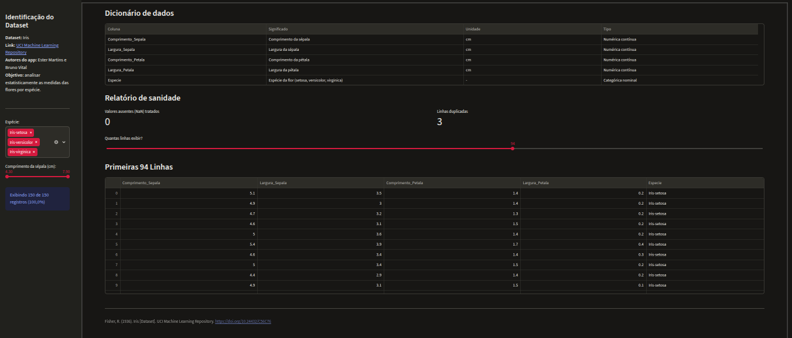
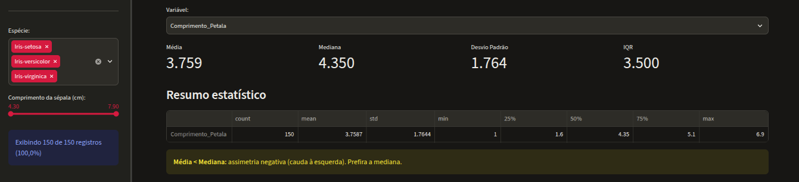
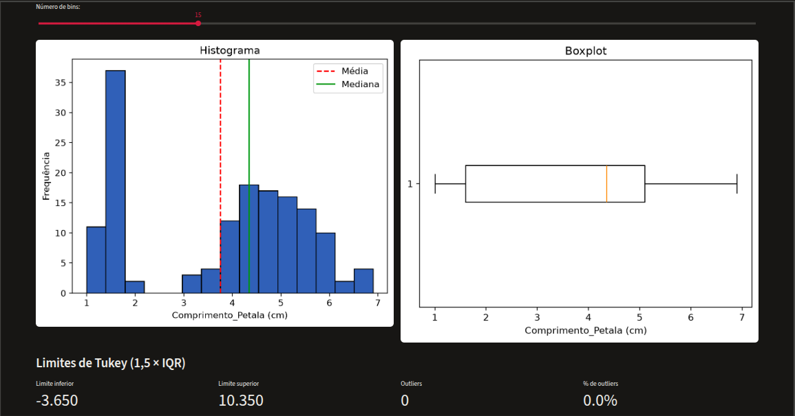
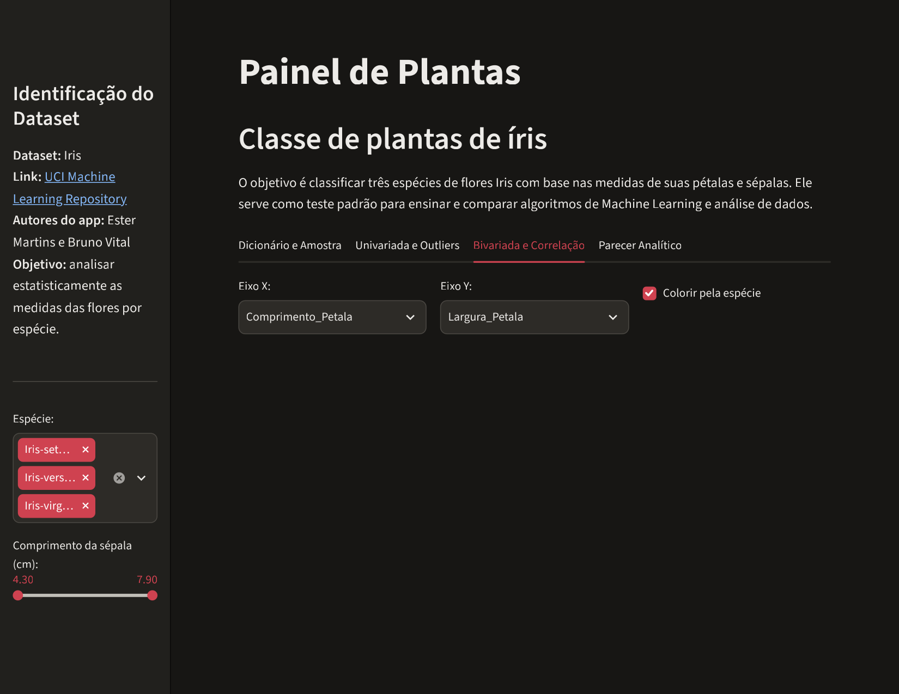
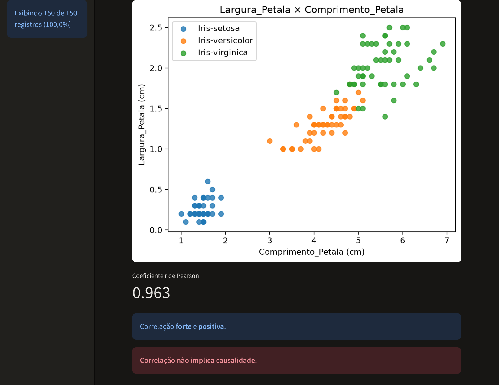
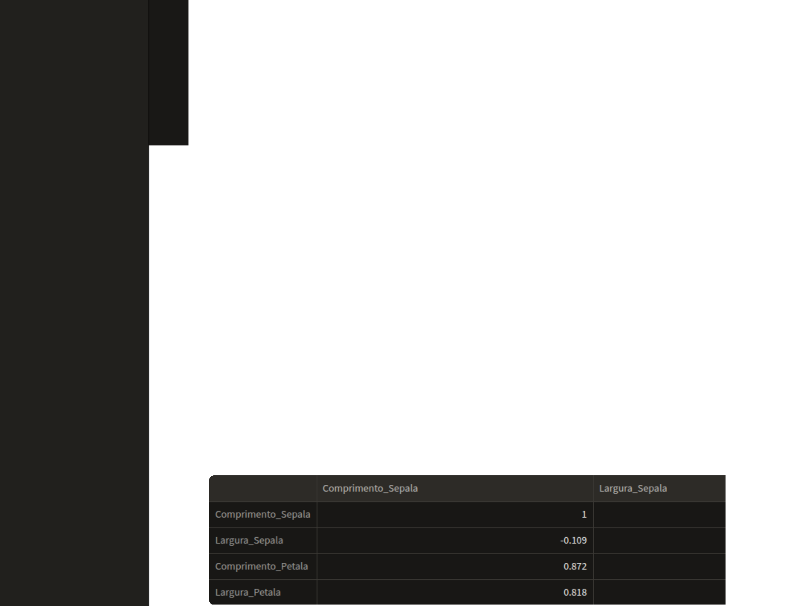
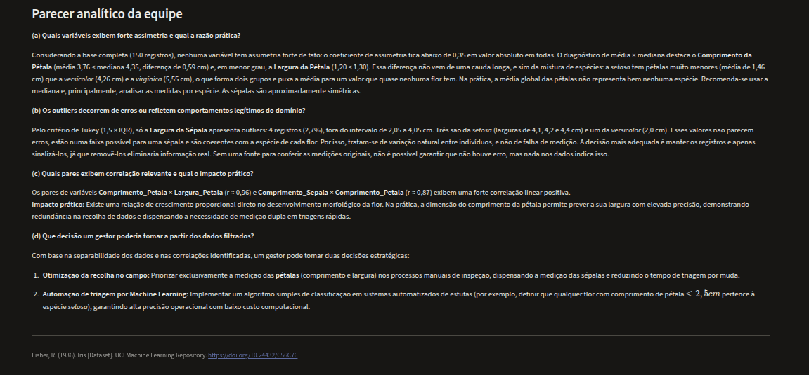

# 📊 Dashboard Iris - Estatística Descritiva com Streamlit

Aplicação web interativa desenvolvida em **Streamlit** para exploração estatística univariada e bivariada, detecção de *outliers* pelo critério empírico de Tukey e análise de correlação no dataset **Iris**.

---

## 📌 Sobre o Dataset

* **Dataset:** Iris (Fisher, 1936)
* **Fonte:** [UCI Machine Learning Repository](https://archive.ics.uci.edu/dataset/53/iris)
* **Objetivo:** Analisar estatisticamente e comparar as medidas morfológicas das sépalas e pétalas das três espécies de flores (*setosa*, *versicolor* e *virginica*).

---

## 📁 Estrutura do Repositório

```text
.
├── app.py                   # Script principal da aplicação Streamlit
├── requirements.txt         # Dependências de pacotes Python
├── dados/
│   └── dataset_uci.csv      # Base de dados (iris.csv)
└── README.md                # Documentação do projeto
```

# Capturas de tela
 
### Aba 1: Dicionário e Amostra

 
### Aba 2: Univariada e Outliers
Variável com assimetria entre média e mediana (Comprimento da Pétala):
 

 
Variável com outliers (Largura da Sépala):
 

 
### Aba 3: Bivariada e Correlação



 
### Aba 4: Parecer Analítico



---

## 🚀 Como Executar o Projeto

Siga os passos abaixo para configurar o ambiente virtual e rodar a aplicação localmente.

### 1. Acessar a pasta do projeto
No seu terminal, navegue até o diretório do projeto:
```bash
cd meuprojeto
```

### 2. Criar o Ambiente Virtual (`.venv`)
Execute o comando abaixo para criar um ambiente virtual isolado:
```bash
python -m venv .venv
```
> A pasta `.venv` será criada na raiz do seu projeto para armazenar os pacotes do Python.

### 3. Ativar o Ambiente Virtual

Selecione o comando adequado para o seu sistema operacional:

* **Windows (PowerShell):**
  ```powershell
  .\.venv\Scripts\Activate.ps1
  ```
  *(Nota: Se houver bloqueio na execução de scripts no PowerShell, execute antes: `Set-ExecutionPolicy -ExecutionPolicy RemoteSigned -Scope Process`)*

* **Windows (Prompt de Comando - CMD):**
  ```cmd
  .venv\Scripts\activate.bat
  ```

* **macOS / Linux:**
  ```bash
  source .venv/bin/activate
  ```

Após a ativação, a indicação `(.venv)` aparecerá no início da linha do terminal.

### 4. Instalar as Dependências
Com o ambiente virtual ativado, instale as bibliotecas necessárias:
```bash
pip install -r requirements.txt
```

### 5. Executar o Aplicativo Streamlit
Inicie o servidor local do Streamlit:
```bash
streamlit run app.py
```

Se o comando direto não for identificado, utilize a chamada explícita do módulo Python:
```bash
python -m streamlit run app.py
```

A aplicação será aberta automaticamente no seu navegador padrão no endereço `http://localhost:8501`.

---

## 🛑 Como Encerrar a Execução

* **Parar o servidor do Streamlit:** Pressione `Ctrl + C` no terminal.
* **Desativar o ambiente virtual:** Digite o comando abaixo no terminal:
  ```bash
  deactivate
  ```

---

## 👥 Autores

* **Ester Martins**
* **Bruno Vital**

---

## 📚 Referências

* [Streamlit Documentation — Command Line Setup](https://docs.streamlit.io/get-started/installation/command-line)
* Fisher, R. (1936). *Iris*. UCI Machine Learning Repository. [https://doi.org/10.24432/C56C76](https://doi.org/10.24432/C56C76)